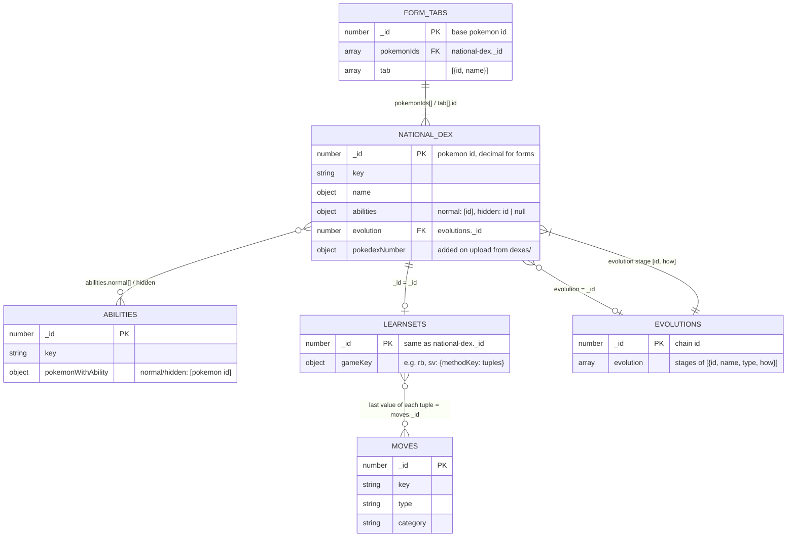
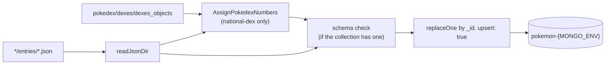

# Pokemon Data Docs

Documentation for the objects in the `src/pokemon/*/entries/` folders.
Each `entries/` folder is one MongoDB collection: every JSON file is one
document, and its `_id` is the Mongo `_id`.

## Collections

| Collection     | Source folder                  | Upload script            | Schema                   |
| -------------- | ------------------------------ | ------------------------ | ------------------------ |
| `national-dex` | `src/pokemon/pokedex/entries`    | `npm run upsert:pokemon`    | `pokedex/schema.json`    |
| `abilities`    | `src/pokemon/abilities/entries`  | `npm run upsert:abilities`  | `abilities/schema.json`  |
| `moves`        | `src/pokemon/moves/entries`      | `npm run upsert:moves`      | `moves/schema.json`      |
| `learnsets`    | `src/pokemon/learnsets/entries`  | `npm run upsert:moves`      | none                     |
| `evolutions`   | `src/pokemon/evolutions/entries` | `npm run upsert:evolutions` | `evolutions/schema.json` |
| `form-tabs`    | `src/pokemon/formTabs/entries`   | `node src/pokemon/formTabs/upsert.js` | none           |

One page per collection:

- [national-dex](collections/national-dex.md): the pokemon themselves
- [abilities](collections/abilities.md)
- [moves](collections/moves.md)
- [learnsets](collections/learnsets.md): which pokemon learn which moves
- [evolutions](collections/evolutions.md): evolution chains
- [form-tabs](collections/form-tabs.md): form switcher for a pokemon
- [pokedex entries](pokedex-entries.md): which files have
  `pokedexEntries`, and which forms are missing them

Also:

- [Not uploaded](not-uploaded.md): `forms/`, `dexes/`, `competitive/`
  and other data that feeds the collections but isn't one
- [Known issues](known-issues.md): broken or out-of-date references

## How everything connects

### Reference table

Every link between collections is a plain value; Mongo doesn't enforce
any of them. Look-ups happen on the website server.

| From                                   | To                  | Notes                                    |
| -------------------------------------- | ------------------- | ---------------------------------------- |
| `national-dex.abilities.{normal[],hidden}` | `abilities._id` | ids only; names come from `abilities` |
| `abilities.pokemonWithAbility.{normal,hidden}[]` | `national-dex._id` | reverse of the line above, built by `abilities/updatePokemonWithAbility.js`; includes forms |
| `learnsets._id`                        | `national-dex._id`  | one learnset per pokemon, 1:1            |
| `learnsets.{game}.{method}[][last]`    | `moves._id`         | `moveId` is always the last tuple value  |
| `national-dex.evolution`               | `evolutions._id`    | chain the pokemon belongs to (see [known issues](known-issues.md)) |
| `evolutions.evolution` stage `[id, how]` | `national-dex._id`  | every pokemon in the chain               |
| `form-tabs._id`                        | `national-dex._id`  | the base form                            |
| `form-tabs.pokemonIds[]`, `tab[].id`   | `national-dex._id`  | every form shown in the tab bar          |

Copies such as `name` next to an `id`, and `type` inside evolution
stages, are denormalised for display. If the source changes, the copies
must be rebuilt.

## IDs

- A pokemon's `_id` is its national dex number: `6` is Charizard.
- Forms use the base number plus a decimal: `6.1` is Mega Charizard X,
  `1017.2` is Hearthflame Mask Ogerpon. The same decimal id is used in
  `national-dex`, `learnsets`, `form-tabs` and `forms/`.
- `abilities._id` and `moves._id` match PokeAPI ids.
- `evolutions._id` is a chain number that has nothing to do with pokemon
  ids: chain `2` is Charmander → Charmeleon → Charizard.

Short keys (`rb`, `sv`, `lv`, `tm`...) are listed in
[`src/pokemon/KEYS.md`](../src/pokemon/KEYS.md).

## Upload flow

- The database name is `pokemon-${MONGO_ENV}` (`dev`, `test` or `prod`).
- If any document fails its schema, nothing in that collection is
  uploaded.
- `replaceOne` swaps the whole document, so fields removed from a file
  disappear from Mongo on the next upload. Documents whose file was
  deleted are **not** removed from Mongo.
- `npm run upsert:all` runs abilities, moves (+ learnsets), pokemon and
  evolutions. It does not upload `form-tabs`.
